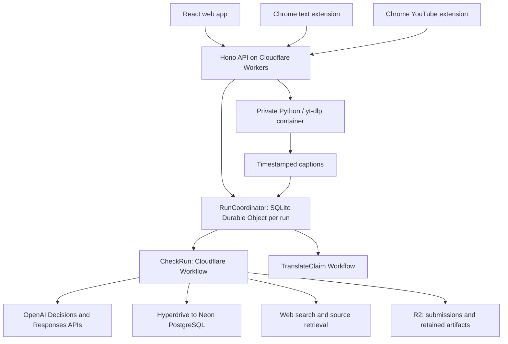

# Wingman engineering handoff

Updated 2026-11-21. Code baseline: `32b65c1` on `main`. This is a working hackathon system, with deliberate limits described below. Start here, then use the linked implementation and task specs for detail.

## Romina's project closeout

Closed on Romina's side on 2026-11-21, at her instruction after the hackathon ended. Her contribution is complete. The code, brand assets, documentation, and engineering handoff are retained in this repository. Further development on her side requires a new request.

Brian's deployment verification remains a requested team follow-up, tracked in the next section. Its completion and Brian's acceptance are unconfirmed. This closeout records Romina's finished involvement; it does not establish that the latest UI is deployed. The technical backlog below remains available for any future team work.

## For Brian: confirm the latest UI deployment

Requested by Romina on 2026-11-21. Status: awaiting verification.

Brian, please check whether the active Cloudflare deployment of [Wingman](https://council-checker-dev.snapnda.workers.dev) includes [PR #21](https://github.com/bkarlovitz/openai-devday-exchange/pull/21), merged as `32b65c106f1348942a2c70af68aae76b5136c39e` on 2026-11-21 at 17:36 Europe/Madrid. This merge introduced the Night Broadcast UI and verdict reactions.

Check Workers & Pages → `council-checker-dev` → Deployments. Confirm the deployed source revision includes that merge, or compare the live JavaScript/CSS with a fresh build containing it. A deployment timestamp alone does not establish which code was released. Check the hosted extension ZIPs too, since both Chrome panels changed.

Please record the active deployment/version ID, source revision or asset comparison, and result here. If the live build is older, flag that deployment is still needed. Codex could not verify it on 2026-11-21: the live site timed out and the local CLI had no authenticated Cloudflare access. The previously verified release used `37aa194`.

## What the system does

Wingman checks factual claims in supplied text against retained official datasets, council records, and retrieved web sources. It preserves the original quote and returns a verdict, cited evidence, uncertainty, and validated calculations. The web app and two separate Chrome extensions share the same backend. English, Spanish, and Catalan are supported.

Text is the core input contract. Transcripts and document text can come from other producers; the checker does not depend on audio transcription. The web UI imports `.txt`, `.srt`, and `.vtt`. Stored council PDFs have a separate ingestion/extraction pipeline. Arbitrary uploaded PDFs and audio transcription are not implemented by the text API.

- App: <https://council-checker-dev.snapnda.workers.dev>
- Curated extension examples: <https://council-checker-dev.snapnda.workers.dev/demo.html>
- [Detailed README](../README.md), [demo runbook](demo-plan.md), [example inputs](../eval/demo/).

## Architecture and request lifecycle



1. A client creates a UUID `submissionKey` and submits original text, optionally with source metadata and speaker/timestamp passage offsets. Reusing a key with the same payload returns the same run; a changed payload returns `409`.
2. The coordinator persists the run and starts its Workflow. R2 retains submissions and intermediate artifacts. Clients poll the run and load individual claim details.
3. Extraction divides long text into overlapping sections, identifies claims, and anchors quotes to the original UTF-16 spans. Repeated equivalent claims can share a check while retaining their occurrences. Unanchored candidates produce extraction warnings.
4. Checking starts as sections publish, with up to two claim-checking lanes. Short inputs also receive an advisory checkability notice. Checkability and truth are separate: an incorrect factual claim is still checkable.
5. Decisions classifies each claim and routes it to a suitable dataset or general research. Research queries pinned dataset snapshots, searches extracted council passages, or searches the web and retrieves source text. The initial pass has a three-action application tool budget; this is not an unlimited research agent.
6. Decisions judges evidence relevance, sufficiency, and conflict. These flags are advisory. The assessor independently evaluates the retained evidence and produces a structured assessment.
7. Code validates citations and arithmetic against the actual source values and units. A bounded repair can correct invalid model proposals; it does not bypass validation. The coordinator publishes each result independently, so a run can finish with successful claims and technical errors together.
8. Retries reuse retained checkpoints/evidence where applicable and preserve completed siblings. Language changes translate explanation and uncertainty while preserving the verdict, original quotation, evidence, and arithmetic.

Formal verdicts: `supported`, `contradicted`, `mixed_evidence`, `insufficient_evidence`. Technical failure and `not_checkable` are separate states. “Complete” does not imply every claim succeeded: inspect `errorCount` and extraction warnings.

## OpenAI integration

| Responsibility | API | Config variable / default model |
| --- | --- | --- |
| Checkability, topic/dataset routing, evidence triage | `/v1/decisions` | `DECISION_MODEL=gpt-6-luna` |
| Traceable claim extraction | `/v1/responses` | `EXTRACT_MODEL=gpt-5.4-mini` |
| Structured research plans and source excerpt selection | `/v1/responses` | `RESEARCH_MODEL=gpt-5.4-mini` |
| Hosted web search | `/v1/responses` | `SEARCH_MODEL=gpt-6.2-astra` |
| Grounded assessments and explanation translation | `/v1/responses` | `EXPLAIN_MODEL=gpt-5.4-mini` |

These are repository defaults, configurable at deployment. The backend uses `OPENAI_API_KEY`; clients never receive it. See [Decisions implementation](../apps/api/src/services/decisions.ts), [structured generation](../apps/api/src/services/generate-object.ts), [research](../apps/api/src/research/research-claim.ts), and [assessment validation](../apps/api/src/services/assess.ts). Optional catalogue embeddings use `text-embedding-3-small`; do not assume a vector-search research loop is implemented.

## Where to change things

| Location | Responsibility |
| --- | --- |
| `apps/web` | React/Vite app, TanStack Router, Effect Atom state, imports and shared-result pages |
| `apps/extension` | Selected-text/paste Chrome side panel, per-tab restoration and web handoff |
| `apps/livefact-youtube` | YouTube captions, timeline, notifications, saved replay, link import |
| `apps/api/src/routes` | Submission, YouTube, retry, translation, and development evidence HTTP routes |
| `apps/api/src/coordinator` | Persisted run state, revisions, deduplication and attempt ownership |
| `apps/api/src/workflows` | Extraction/research/assessment orchestration and translation |
| `apps/api/src/research` | Source collections, catalogue, bounded query plans, source reading, arithmetic |
| `packages/contracts` | Effect Schema contracts and shared API client; change this before changing client/server payloads |
| `packages/ui` | Shared result/evidence views, logo, fonts, theme, expressions and verdict motion |
| `tooling/infra/alchemy.run.ts` | Cloudflare infrastructure, bindings, models, secret injection and assets |
| `scripts`, `db` | Python ingestion, PDF/HTML extraction, SQL schema/migrations, yt-dlp service |
| `.viktor` | Repository-owned architecture, frontend contract, task specs and historical work log |

Read [AGENTS.md](../AGENTS.md), [stack](engineering/stack.md), and [verification policy](engineering/verification.md) before implementation. Checks run locally; do not add GitHub Actions. Historical `council-*`, `livefact-*`, and `.viktor` names remain intentionally for compatibility.

## Evidence data and its limits

Neon is the evidence store, not the run store. PostgreSQL retains dataset metadata, immutable snapshots, original JSONB rows, source document bytes, extracted passages and extraction status. Snapshot IDs, hashes, row numbers and document page/passage references make evidence traceable. Run state lives in the coordinator; R2 holds run artifacts.

| Collection | What it can establish | Important distinction |
| --- | --- | --- |
| Incasòl (`incasol`) | Registered rents/contracts by municipality, period and published price band | A band-specific average is not the average of all rents |
| Population (`population`) | Municipal register counts at explicit reference dates and geographic scopes | Preserve territory codes and avoid double-counting overlapping scopes |
| Tourist flats (`tourist-flats`) | Published register entries and capacity by district/neighbourhood | Distinct expedients, capacity places and legal status are different concepts; a current snapshot cannot prove a historical count |
| INE (`ine-59061`) | Published rental index/variation series | Indices are not rent amounts in euros |
| Council records/minutes | Exact extracted official passages with document/page references | Approval of spending does not prove payment happened |

See [source guidance](../apps/api/src/research/sources.ts), [database handoff](../.viktor/database-handoff.md), and [topic coverage](../.viktor/topic-coverage.md). Loaded data is a snapshot, not a continuously refreshed live feed. Inspect the actual database catalogue for current coverage; ingestion code supporting a source does not prove it is loaded.

## Local setup

Use Node.js 22.18+, npm, Python 3.10+, and Docker when using local PostgreSQL or the caption container.

```sh
npm ci
cp -n .env.example .env
# Fill the ignored .env with your own credentials/configuration.
npm run dev
```

Open `http://localhost:8787`. Alchemy emulates Workers, Workflows, R2 and the coordinator locally. Configure `OPENAI_API_KEY` for model calls and `ALCHEMY_PASSWORD` for encrypted local deployment state. Frontend hot reload: run `npm run dev --workspace @council/web` in a second terminal; Vite proxies `/api` to 8787. The main dev command otherwise serves a built frontend.

To prepare a local evidence database:

```sh
docker compose up -d --wait
python3 -m venv .venv
.venv/bin/pip install -r scripts/requirements.txt
.venv/bin/python scripts/extract_documents.py --migrate-only
.venv/bin/python scripts/ingest.py --source incasol --source population --population-files 2
# Optional council records and text extraction:
.venv/bin/python scripts/ingest.py --source council --source minutes
.venv/bin/python scripts/extract_documents.py
```

Docker initializes `db/schema.sql` only for a new volume. For a new Neon database, apply that base schema first, then run the ordered document migrations. Keep `apps/api/src/db/schema.ts` in sync with SQL changes. Python scripts read exported environment variables, not the root `.env` automatically: export `DATABASE_URL` explicitly when targeting Neon. With no exported database override they use local Docker defaults. Do not run ingestion against a shared database accidentally.

`LOCAL_EVIDENCE_DATABASE_URL` controls the local Worker connection. Deployment uses `HYPERDRIVE_ORIGIN` (direct Neon PostgreSQL URL), falling back to `DATABASE_URL`. Hyperdrive query caching is disabled in the current infrastructure. The README contains full ingestion, inspection and comparison commands.

## Client/API contract

| Endpoint | Purpose |
| --- | --- |
| `POST /api/runs` | `{submissionKey, text, explanationLanguage?, source?, passages?}` → `202 {runId, url}` |
| `GET /api/runs/:runId` | Run, submission, revision, progress, checkability, claims and errors |
| `GET /api/runs/:runId/claims/:claimId` | Retained research, evidence and assessment for one claim |
| `POST /api/runs/:runId/retry` | `{commandId, claimId?}`; omit claim ID to retry failed stages |
| `POST /api/runs/:runId/language` | `{commandId, language: "en" | "es" | "ca"}` |
| `POST /api/runs/youtube` | `{submissionKey, url, fromSeconds, toSeconds?, explanationLanguage?}` → normal run receipt |

Text is limited to 200,000 Unicode code points. Passage/quote offsets are JavaScript UTF-16 indices with exclusive ends. Preserve original whitespace. A new deliberate mutation gets a new UUID `commandId`; a transport retry reuses the same UUID and payload. Poll translation progress even when checking is complete. Use the [actual schemas](../packages/contracts/src/index.ts) and [frontend contract](../.viktor/frontend-contract.md) as the source of truth.

## Chrome and YouTube

These are **two separate unpacked extensions**. Build both with `npm run build:extension`, then use Chrome developer mode → Load unpacked:

- Text: `apps/extension/dist`. Select text → right-click → **Check claims**. The panel restores each tab's run and links to the same web result. Its pinned ID is `fhfebjohcmngiobjfcamkcknhmfhafbk`; preserve the manifest key.
- YouTube: `apps/livefact-youtube/dist`. Live mode reads visible captions; turn CC on. Link mode retrieves a server-side caption interval of at most 180 seconds, even if visible CC are off, when a track is available.

After rebuilding, reload each extension in `chrome://extensions`; refresh YouTube tabs to replace old content scripts. Text API origin, manifest host permissions and backend `EXTENSION_ORIGINS` must agree. YouTube requests are mediated by its extension worker. See each extension's README for controls.

Download aliases are `/downloads/wingman-extension.zip` and `/downloads/wingman-youtube.zip`. Packages are generated and ignored by Git. Release versions at this baseline: text **0.1.3**, YouTube **0.4.10**. Installing an unpacked ZIP does not create automatic Chrome updates.

Workers cannot directly execute `yt-dlp`. The link importer uses a private Cloudflare Container running `scripts/youtube_import.py`, enabled by `YOUTUBE_IMPORT_CONTAINER=true` and a shared server-side `YOUTUBE_IMPORT_TOKEN`. Docker must be running for the image build. Alternatively set `YOUTUBE_IMPORT_URL` to a separate compatible importer. Caption-less intervals return `422`; upstream/importer failures return `503`. There is no audio transcription fallback.

The prepared YouTube URL with `#livefact-demo` replays previously computed results marked **Guardado**. It is not fresh live verification. The ordinary URL plus live/link controls performs a new check. [Demo runbook](demo-plan.md) distinguishes fixtures, saved results and live paths.

## Verification and deployment

```sh
npm run typecheck
npm run lint
npm test
npm run build
# With deployment credentials and Docker if the container is enabled:
npm run deploy:dev
```

The full build generates both extension ZIPs, builds web assets and dry-runs Worker bundling. Deployment rebuilds clients and uses Alchemy to provision/update the Worker, R2, coordinator, Workflows, Hyperdrive and optional container. It does not ingest data or migrate Neon automatically. Local and deployed run stores are separate.

Use `npx alchemy configure` for Cloudflare OAuth. If you create a named profile, set the exact `CLOUDFLARE_PROFILE` in `.env`; login against an unconfigured `default` profile will fail. API-token credentials are another option. Keep `ALCHEMY_PASSWORD` and existing Alchemy state consistent; do not delete state to fix a deployment. Do not commit `.env`, credentials or generated packages.

Last deployment personally verified during this handoff session used application code `37aa194` (subsequent `cbdf21c` was documentation only): the live homepage matched the build and hosted ZIP versions were 0.1.3/0.4.10. All 87 tests, typecheck, lint, build and browser smoke checks passed for that integration. PR #21 then landed as `32b65c1`, changing the branding further; do not assume that later code is deployed or covered by the earlier verification. Check the current deployment before reporting release status. The latest styling lives in shared `brand-tokens.css` and the design docs include historical references.

For a change, run the relevant checks and a browser smoke test of the affected client. Preserve authentic source labels and uncertainty. A demo saved result proves only that earlier check, not deterministic behavior of all future model calls.

## Troubleshooting and next work

| Symptom | First place to look |
| --- | --- |
| Submission returns `503` or extraction fails | Worker/Workflow logs, OpenAI key/model access, provider timeout and run error state |
| Dataset missing or connection fails | Hyperdrive origin/binding, Neon availability, loaded catalogue and migrations |
| Incorrect date/scope/count comparison | Pinned snapshot, query filters, complete aggregate vs preview, source units and research guidance |
| Calculation operands rejected | `assess.ts` and `research/calculate.ts`; never fix this by weakening source/unit validation |
| New UI absent | Build/redeploy web; replace and reload unpacked extension; refresh YouTube tab |
| Run appears stuck | Extraction progress, claim states, `errorCount`, translation state, Workflow attempt ownership |
| YouTube import unavailable | Caption availability, interval, container startup, importer token and upstream restrictions |

Development evidence inspection lives under `/api/dev/evidence` and is enabled locally or with `ENABLE_EVIDENCE_DEBUG=true`. It is for troubleshooting, not a production access-control boundary. Run URLs currently grant access to submissions. Authentication, tenancy, robust abuse controls and production access policies are not completed. Keep model spend controls in the owning OpenAI project; there is no application-enforced monetary budget.

The [task index](../.viktor/tasks.json) remains the work queue; some specs predate shipped changes, so read code and the [work log](../.viktor/logs/LOG.md) before duplicating work:

1. **TASK-005:** bounded deeper investigation for unresolved/conflicting claims. The initial pass exists; the configurable follow-up agent loop is unfinished.
2. **TASK-009:** validate and document topic/data coverage. Its task flag remains open even though source/query integration exists; reconcile the owner's work and actual database contents.
3. **TASK-011:** complete end-to-end evaluation across authentic inputs, clients and deployed services. Existing automated and smoke checks do not close the full evaluation task.
4. Verify/deploy the latest merged UI, then prioritize demonstrated failures and evidence quality over more presentation features. Audio transcription, frame analysis, speaker identification and video-wide reports remain separate future work; see [video roadmap](roadmap.md).

For two people: one can own backend research/data/evaluation while the other owns clients/UX. Coordinate changes through `packages/contracts`, keep shared `packages/ui` edits small, fetch before pushing, and designate one deployer so releases do not overwrite each other.
